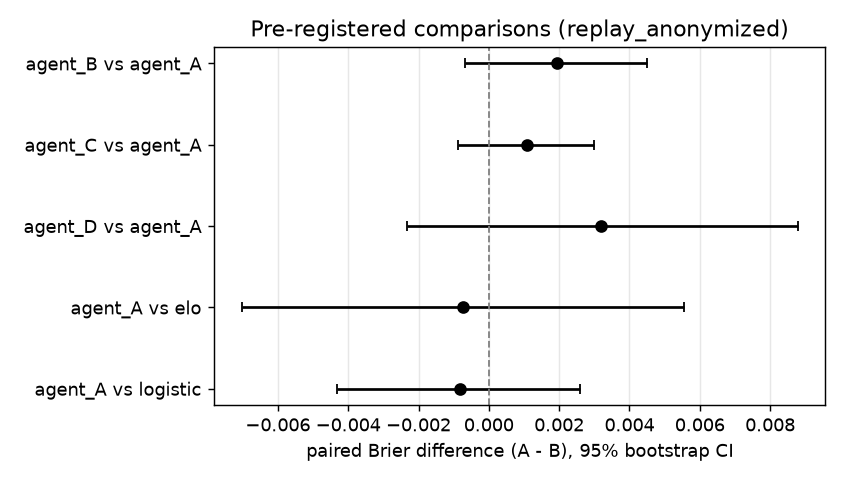
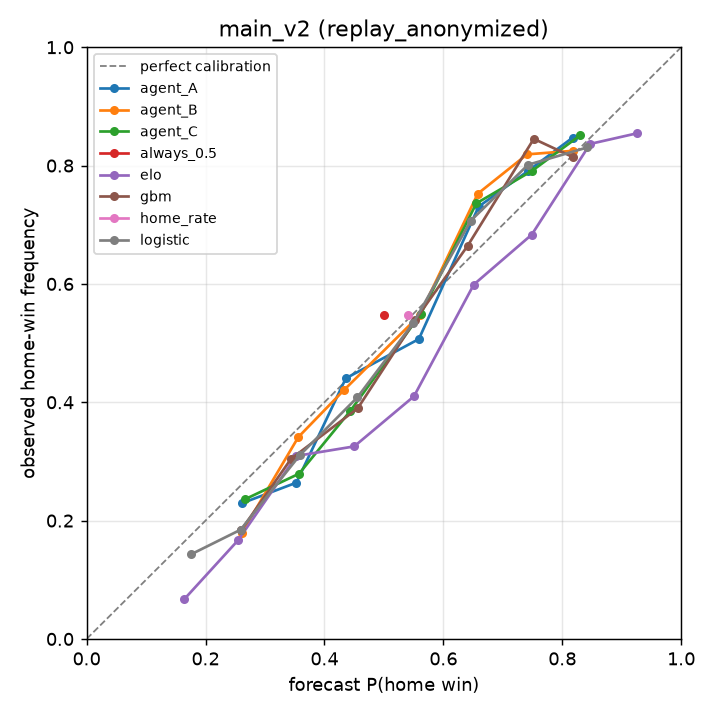

# forecast-lab: Do Agent Design Techniques Make LLMs Better Forecasters?

A reproducible, leakage-safe test of whether an LLM *agent* (one that calls tools, remembers past predictions, or critiques its own draft) forecasts better than a plain tool-using LLM, and better than classical statistical models. The first domain is NBA game outcomes. The core is domain-agnostic, so NFL, stocks or anything else with timestamped data can be added.

Full result tables are in [REPORT.md](REPORT.md). Install and run instructions are in [docs/USAGE.md](docs/USAGE.md). Every design decision, with its reasoning, is in [docs/DECISIONS.md](docs/DECISIONS.md).

## Background

"Agentic" forecasting is the idea that wrapping an LLM in extra machinery should make it a better forecaster. The machinery usually means tools that fetch data, a memory of earlier predictions and how they turned out, and a step where the model critiques and revises its own draft. These techniques are popular and add real cost (more tokens, more latency, more moving parts), but they are rarely tested head to head against a simple baseline on the same questions.

NBA games are a good test bed. There is a steady supply of binary questions ("will the home team win?"), the outcomes are known within hours, there is plenty of public data, and well-understood statistical models (Elo ratings, logistic regression) exist to compare against. The goal of this project is the methodology: a fair comparison, honestly reported. A null result, with confidence intervals, sample sizes and costs, counts as a finding.

## Hypothesis

We started from three hypotheses, one per technique, and fixed them in writing before running anything (the configs are committed to git, and the harness refuses to run an experiment whose config is not committed and unmodified).

1. **Memory helps.** An agent that keeps a short journal of lessons from past games will be better calibrated than one that starts fresh every game.
2. **Self-critique helps.** An agent that writes a draft forecast, critiques it, and then revises will have a lower error than one that answers once.
3. **A confident but false hint hurts.** If a prompt contains a plausible claim that the data contradicts (for example, "team X is on a back-to-back" when it is not), a robust agent should check the data and ignore it.

Two further questions frame these. Do agents beat classical models at all? And, because LLMs may have memorized past NBA results during training, can a backtest on past games be trusted?

## Key Considerations

Does an LLM with simple stat lookups forecast as well as a logistic regression on Elo and rest features? Which of memory, self-critique and a larger model, if any, moves the error in a way that is distinguishable from noise? When a result looks better or worse, is the difference bigger than what random game outcomes would produce on their own? Can any of this be trusted if the model has already seen the final scores? And what does each technique cost per forecast, relative to what it buys?

## Data

Game data comes from stats.nba.com through the `nba_api` package: exact tip-off times and final scores from the schedule endpoint, and box scores from the game-finder endpoint, which give possessions and therefore net rating. Six seasons are cached, and the baseline evaluation covers 4,920 games from October 2022 onward (earlier games serve as warm-up for the models that learn from history). The raw cache is not committed. A fresh clone rebuilds it with one command, and each run records a content hash of the data (`dd9e4a62ab14bbcf` for the historical snapshot) so a run can be checked against a rebuilt cache.

Every record carries an *availability time*: a game's result is treated as knowable 210 minutes after tip-off, which is deliberately later than a real game ends. All data access goes through a single `DataStore` that only returns records available strictly before the forecast time, so neither the agents nor the baselines can see a game's own result or anything after it.

Two data gaps matter. There is no free historical betting-market data, so the market baseline is missing and is not approximated. There is also no reliable historical injury data, so the injury tool is switched off in replay. Both are listed under Limitations below.

## Process

1. Cache six NBA seasons and build the leakage-safe `DataStore`.
2. Fit the classical baselines walk-forward, updating them game by game in time order, so each one only ever trains on games before the one it predicts.
3. Pre-register each experiment by committing its config (games, variants, models, hypotheses, the exact comparisons to test) before running it.
4. For each game, run every agent variant at a forecast time 60 minutes before tip-off. Each variant outputs a probability that the home team wins.
5. Log the prediction to an append-only, hash-chained ledger, then reveal the outcome, then (for the memory variant) write a journal note.
6. Score every forecast, compare variants on the *same games*, and generate the report.

### The baselines

| Baseline | What it is |
|---|---|
| Always 0.5 | A coin flip. The floor every model should beat. |
| Home rate | The running home-win rate (about 55%). |
| Elo | A rating system with FiveThirtyEight's published NBA settings. They were set before seeing this data and were not tuned. |
| Logistic regression | Walk-forward, using Elo and rest-based features. Refit every 14 days. |
| Gradient boosting | The same features, with a tree-based model. Refit every 14 days. |

The two learned models do not forecast until they have seen 400 games.

### The agent and its variants

The agent is Claude Haiku 5.5 (Sonnet 5.5 for one comparison). It can call three typed tools, each restricted to the forecast time: team form over the last N games (record, net rating, average margin), rest days, and head-to-head history. It finishes by calling `submit_forecast` with a probability between 0.05 and 0.95. The variants differ in one thing each:

| Variant | What changes | Tests |
|---|---|---|
| **A** | The base agent: tools plus `submit_forecast`. | The reference for everything below |
| **B** | Adds a journal. After each game's result is known, a separate model call writes a note (at most 60 words) on what to do better. The last 10 notes are shown on the next game. | Memory (RQ1) |
| **C** | After the first submission, the agent is asked to critique its own draft and submit a final probability. | Self-critique (RQ2) |
| **D** | Adds a confident hint that the data contradicts: a losing streak, a back-to-back, or head-to-head dominance. Each hint is verified false against the data before it is used. | Robustness to misleading context (RQ3) |
| **R** | Real team names and dates instead of masked ones. | Contamination (RQ5) |
| **G** | Real names plus an "ignore what you remember" instruction. | Whether a guardrail helps (RQ5) |

A planned variant E (typed tools versus a free-form code tool, RQ4) was a stretch goal and was not run.

### How we score

Forecasts are scored with the **Brier score**: the mean squared difference between the forecast probability and what happened (1 for a home win, 0 for a loss). Lower is better. A coin flip scores 0.2500, and a perfect forecaster scores 0. NBA games are noisy enough that good models land around 0.20 to 0.21, so differences between sensible models are small, often in the third decimal place.

Because the differences are small, every comparison is **paired**: two variants are scored on the identical games, and we bootstrap the per-game differences (10,000 resamples) to get a 95% confidence interval. When an interval includes zero, the data cannot distinguish the two. With five comparisons per experiment, p-values are Holm-corrected so that testing several things does not make a lucky result look significant. Log loss, accuracy and calibration error (ECE) are also reported in [REPORT.md](REPORT.md).

### Dealing with contamination

If a model saw the final score of a 2024 game in training, a backtest on that game proves nothing. We attack this from three directions:

- **Masking.** In the main experiment, team names, player names and dates are replaced with tokens like `team-3fa9c1` and `day-9483`, so the agent sees statistics but not identities.
- **A post-cutoff replication.** All 248 games of the 2026-27 season so far tipped off after the model's reported training cutoff (June 2026), so memorization is impossible. Real names are safe to use there.
- **An audit.** A tool-free probe asks the model for the exact final score of games it may have seen. Exact scores are nearly impossible to guess, so a hit rate clearly above the post-cutoff control would be direct evidence of memorization.

### The experiments run

| Experiment | Games | Model | Mode | Purpose | Cost |
|---|---|---|---|---|---|
| `main_v1` | 600 | Haiku 5.5 | masked replay | First main run. Showed a prompt bug in variant C (below). | $2.14 |
| `main_v2` | 1,000 | Haiku 5.5 | masked replay | **Primary experiment**: variants A to D, prompt bug fixed, larger sample. | $3.44 |
| `postcutoff_v1` | 248 | Haiku 5.5 | post-cutoff | Replication that cannot be contaminated. | $0.83 |
| `sonnet_v1` | 400 | Sonnet 5.5 | masked replay | Model size, on a subsample of `main_v2`'s games. | $5.09 |
| `contamination_v1` | 300 | Haiku 5.5 | masked and raw | Variants A, R, G and the recall probe. | $0.67 |

Two earlier runs (`pilot_v1`, `check_c_v1`) were exploratory harness checks and are not evidence. The pilot found three harness bugs, all fixed without changing any hypothesis (see [DECISIONS](docs/DECISIONS.md), P1 to P3). Total spend for the five experiments above was about $12.2 across 7,338 forecasts.

## Results

All numbers below are Brier scores unless stated. A positive "difference" means the first variant is *worse*. Intervals are 95% paired-bootstrap CIs. Complete tables, calibration plots and failure accounting for every run are in [REPORT.md](REPORT.md).

### Does an agent beat the classical models?

No, but it ties them. In the primary experiment (`main_v2`, 1,000 masked games from November 2024 to April 2026):

| Forecaster | Brier | Accuracy |
|---|---|---|
| **Agent A (tools only)** | **0.2059** | 68.8% |
| Elo | 0.2066 | 67.3% |
| Logistic regression | 0.2067 | 68.2% |
| Gradient boosting | 0.2087 | 67.4% |
| Home-win rate | 0.2482 | 54.7% |
| Coin flip | 0.2500 | 45.3% |

Agent A minus logistic regression is −0.0008 [−0.0043, +0.0026], and agent minus Elo is −0.0007 [−0.0070, +0.0055]. Both intervals straddle zero comfortably. The agent is no worse than the classical models, but nothing shows it is better. All four real forecasters are clearly better than the coin flip and the home rate, which is expected, since there is real signal in recent form and rest.

*Each dot is a paired Brier difference (first minus second). Left of the dashed line favors the first variant. Every interval crosses zero.*

On the post-cutoff games the agent is again statistically tied with Elo (+0.0009 [−0.0139, +0.0154]) and, on this smaller sample, numerically behind logistic regression (+0.0117 [−0.0018, +0.0245], p_holm 0.33). That is not a significant gap, but it is a reminder that a 248-game sample is too small to rank models separated by about 0.01.

### Calibration

A forecaster is calibrated if its "70%" calls win about 70% of the time. In `main_v2`, the agent variants and the learned models follow the diagonal closely, while Elo with its fixed home-court advantage lies below it. Its home-team forecasts are too high, which is a known artifact of home-court advantage shrinking since 2020 (see [DECISIONS](docs/DECISIONS.md) O1).

### RQ1: Does memory help? No, and it may hurt.

| Experiment | B − A (Brier) | p (Holm) |
|---|---|---|
| `main_v1`, 600 masked games | −0.0032 [−0.0064, +0.0001] | 0.26 |
| `main_v2`, 1,000 masked games | +0.0019 [−0.0007, +0.0045] | 0.71 |
| `postcutoff_v1`, 248 post-cutoff games | **+0.0082 [+0.0021, +0.0141]** | **0.03** |

The first run hinted that memory might help (p = 0.053 before correction, and 0.26 after). The larger run reversed the sign. That is exactly what a noisy effect near zero looks like, and it is why the primary experiment was run again with more games. On post-cutoff games, memory makes forecasts significantly worse. This is the only comparison across all experiments that survives multiple-comparison correction.

*Why?* We looked after the fact, so treat this as a hypothesis. With real team names, 154 of 248 memory notes (62%) name a specific team ("I leaned on a 10-game margin edge for SAS"), against 0 of 598 when names are masked. Consecutive notes also give opposite advice, such as "shrink toward the base rate" and then "the form gap is a meaningful signal". The agent seems to learn from single-game noise: one surprising result becomes a lesson that gets overapplied. Memory also costs about 40% more per forecast ($0.0010 vs $0.0007).

### RQ2: Does self-critique help? No. It makes the model less confident, not more accurate.

In `main_v2`, critique revised 72% of forecasts, but the Brier score went from 0.2062 (draft) to 0.2070 (final), a change of +0.0007 [−0.0006, +0.0020]. Average confidence (distance from 50%) fell from 0.152 to 0.141. The model hedged more, and the hedging did not buy accuracy. Variant C versus A is +0.0011 [−0.0009, +0.0030] in `main_v2` and +0.0008 [−0.0034, +0.0048] post-cutoff. Both are noise. It also costs about twice as much per forecast ($0.0013 vs $0.0007) and runs about 70% slower.

One caveat is worth recording. In `main_v1`, 2.5% of variant C forecasts failed because the base prompt said "submit exactly once" while the critique step asked for a second submission, and the agent obeyed the base prompt. Failures are scored as 0.5 so that a variant cannot look better by failing on hard games. The prompt was fixed in v2 (0 failures in 1,000 forecasts), and the conclusion held either way: on the 584 `main_v1` forecasts that completed, critique changed Brier by −0.0001.

### RQ3: Does a false hint mislead the agent? Mostly no.

In `main_v2`, 300 games received a hint that was verified false against the data. On average the forecast moved 0.014 toward the hint, and the predicted winner flipped in 5.0% of games. The Brier change was +0.0032 [−0.0023, +0.0088], not distinguishable from zero. The effect depends on the hint type:

| Hint | Shift toward hint (n) |
|---|---|
| "Back-to-back" | +0.032 (89) |
| Head-to-head dominance | +0.012 (110) |
| Losing streak | +0.002 (101) |

The back-to-back claim is the most persuasive, which makes sense: it is a well-known real factor, so a plausible-sounding false claim about it is easiest to believe. The agent largely held to the data, and no system-prompt warning about skepticism was used (we deliberately left it out so we would measure the agent's default robustness rather than an instruction). The post-cutoff run had only 74 hinted games, below the 300-game minimum we set, so it is marked "insufficient data" and is not used for the verdict.

### Does a bigger model help? Not detectably, and it costs 17× as much.

On a 400-game subsample of `main_v2`'s games, Sonnet 5.5 scored 0.2078 against Haiku 5.5's 0.2101 on the same games, a difference of −0.0023 [−0.0070, +0.0025], p_holm 0.69. Per forecast, Sonnet costs $0.0123 and Haiku $0.0007. Improvement over a coin flip per dollar spent: Haiku about 60 Brier points per dollar-per-prediction, Sonnet about 3. If this holds up with more games, the cheap model is the better engineering choice here.

### RQ5: Has the model memorized NBA results? No meaningful evidence.

We asked each model, with no tools, for the exact final score of games it may have seen in training, and compared the hit rate to 100 games played after its training cutoff (which it cannot have seen).

| Model | Exact-score hits, experiment-era games | Exact-score hits, post-cutoff control |
|---|---|---|
| Haiku 5.5 | 2 of 300 across two runs | 0 of 100 (in each run) |
| Sonnet 5.5 | 1.3% | 1.0% |

Hit rates are within noise of the controls. We then tested whether real names change the forecast: real names minus masked names is +0.0010 [−0.0037, +0.0056] on 300 games (p_holm 0.67). The "ignore what you remember" guardrail adds +0.0022 [−0.0014, +0.0060] on top of real names. Neither is distinguishable from zero. So masking appears to cost nothing, and the guardrail appears to do nothing. We cannot prove the model has no memorized results, only that this probe finds none.

### Summary

| Question | Answer |
|---|---|
| Agent vs classical models | Tie. About as good as logistic regression on Elo and rest. |
| RQ1 Memory | No benefit. Significantly worse post-cutoff. |
| RQ2 Self-critique | No benefit. Less confident, same accuracy, about 2× the cost. |
| RQ3 False hint | Mostly robust. Back-to-back claims are the weak spot. |
| Larger model | Not detectably better, about 17× the cost. |
| RQ5 Contamination | No meaningful evidence of memorized results. Guardrail does nothing measurable. |

The plain tool-using agent is about as good as a logistic regression, and each added technique either did nothing or hurt. That is worth knowing before adding complexity.

## Limitations

- **Sample size.** Single-game outcomes are noisy. Brier differences of about 0.002 need thousands of games to resolve. Several intervals here would still be wide enough to hide a real effect of that size, so "no significant difference" means "no detectable difference", not "no difference".
- **One domain, one task.** These are NBA home-win probabilities, forecast from simple team statistics, using one model family. Results may not carry over to harder questions, richer data, or other tasks.
- **No market baseline.** Betting odds are the strongest public benchmark, and no free historical source exists. Nothing here claims to beat the market.
- **No injury data.** The injury tool is disabled in replay because reliable historical injury reports were unavailable. A real forecaster would use them.
- **Self-reported training cutoff.** The post-cutoff boundary relies on the cutoff the model reports (June 2026). Games from October 2026 leave a margin of more than three months.
- **Model drift and sampling.** Hosted models can change behind a fixed ID, and current models reject temperature settings, so variance is estimated with repeated runs rather than a fixed seed. Every record logs the model ID and date.
- **The memory explanation is exploratory.** It was found after seeing the results and was not pre-registered.

## Further Questions

- **Can memory be fixed?** If notes are restricted to team-agnostic calibration lessons, does the harm disappear? This needs a new pre-registered config.
- **Do agents help where classical models are weak?** The NBA is well served by Elo. A domain with messier, text-heavy evidence (news, filings, injury reports) is where tools and reasoning might add value.
- **What does the agent add beyond the baselines?** Does blending the agent's forecast with Elo or logistic regression beat either alone, since their errors may not be fully correlated?
- **Does a skeptical prompt change RQ3?** A prompt that says to verify claims would test a different question, instruction-following, and should be a separate registered condition.
- **What happens with live games and market odds?** Live mode is implemented and passed a dry-run. Growing the sample and adding an odds feed would allow a comparison against the market.
- **Typed tools versus a code tool (RQ4).** Never run.
- **Does the null result survive a larger sample?** Thousands more games would narrow every interval above.

## Next applications

Adding NFL or stocks means writing five domain-specific pieces (loader, derived stats, tools, ML features, hint templates). The as-of guard, ledger, budget, pre-registration, evaluation and reporting are domain-agnostic. See [Adding a domain](docs/USAGE.md#adding-a-domain-nfl-stocks).

## Data Sources

1. NBA schedule, scores and box scores: [stats.nba.com](https://www.nba.com/stats), accessed through the [`nba_api`](https://github.com/swar/nba_api) package.
2. Elo settings: FiveThirtyEight's published NBA Elo methodology (K = 20, home advantage 100, 25% regression to 1505 between seasons).
3. LLMs: Anthropic Claude Haiku 5.5 and Sonnet 5.5 through the Anthropic API, with a Claude Code subscription backend used in two small exploratory runs.

## Further Reading

- [REPORT.md](REPORT.md): every table, calibration plot and failure count from every run.
- [docs/DECISIONS.md](docs/DECISIONS.md): the design decisions, deviations and post-hoc observations, with reasons.
- [docs/USAGE.md](docs/USAGE.md): installation, running experiments, live mode, safeguards and code layout.

Not betting advice, and nothing here claims to beat the market.
