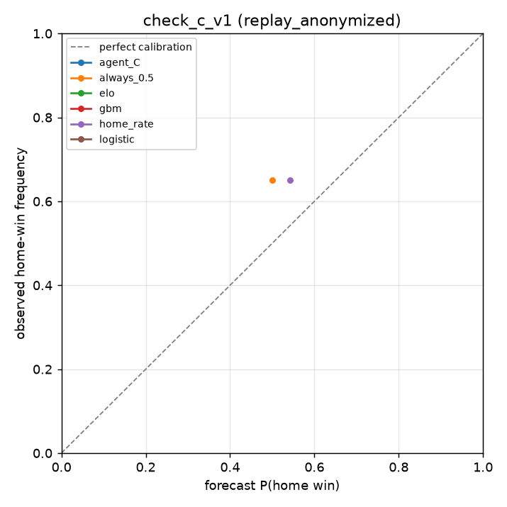
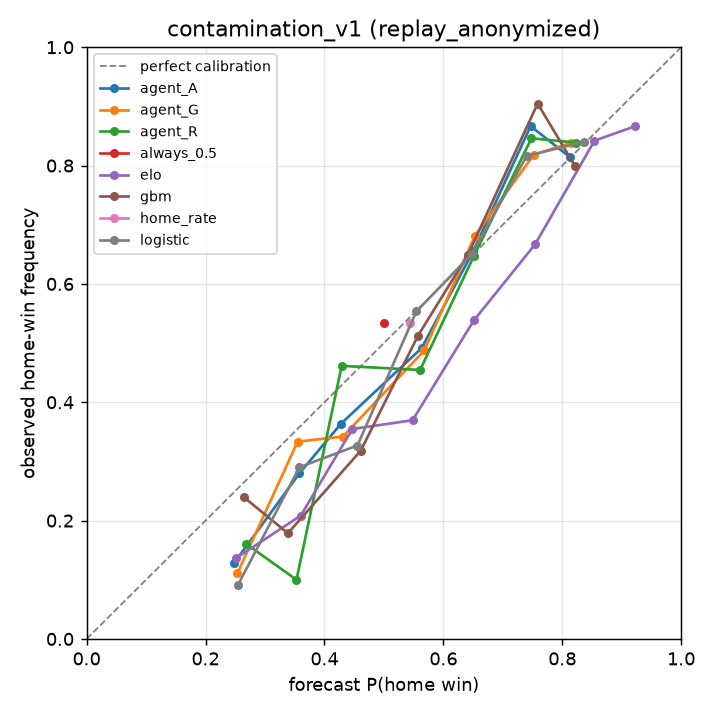
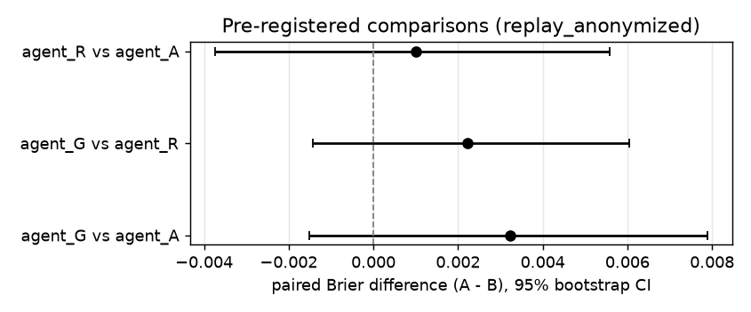
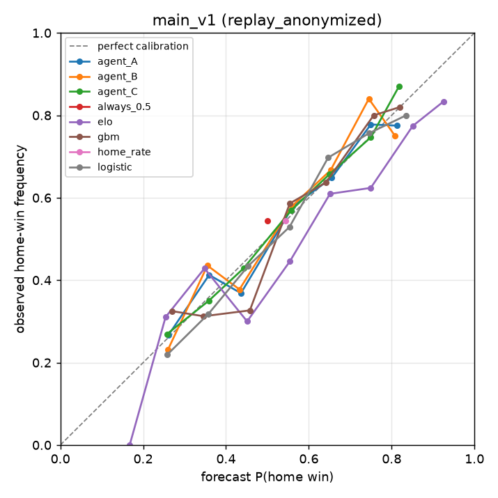
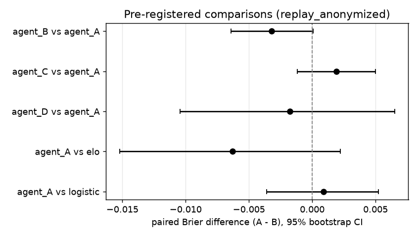
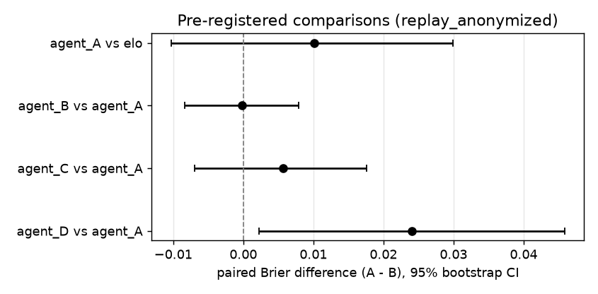

# Results report

_Generated 2026-11-23 15:36 UTC by `forecast-lab report`. Every number is labelled with the mode that produced it._

## Baselines (mode `replay_raw`, walk-forward)

Data snapshot `dd9e4a62ab14bbcf`, forecasts made 60 min before tip-off, evaluated on 4920 regular-season games from 2022-10-01. Δ vs Elo, 95% paired bootstrap CI.

| model | n | brier | log_loss | accuracy | ece | d_brier_vs_ref | ci_low | ci_high | p_holm |
|---|---|---|---|---|---|---|---|---|---|
| logistic | 4920 | 0.2184 | 0.6267 | 0.6486 | 0.0243 | -5.78e-05 | -3.19e-03 | 3.09e-03 | 1.0000 |
| elo | 4920 | 0.2184 | 0.6273 | 0.6506 | 0.0659 | – | – | – | – |
| gbm | 4920 | 0.2188 | 0.6275 | 0.6453 | 0.0145 | 3.86e-04 | -2.53e-03 | 3.37e-03 | 1.0000 |
| home_rate | 4920 | 0.2472 | 0.6876 | 0.5555 | 3.48e-03 | 0.0288 | 0.0240 | 0.0334 | 4.00e-04 |
| always_0.5 | 4920 | 0.2500 | 0.6931 | 0.4445 | 0.0555 | 0.0316 | 0.0262 | 0.0368 | 4.00e-04 |

Market baseline: **missing** for historical games (no free historical odds source; not approximated).

## Experiment `check_c_v1 / 20261123T030629Z-565f80`

- **Mode:** `replay_anonymized`
- **Status:** exploratory, config sha256 `f76e9a00e70e555d`, commit `500c2d1712`
- **Model:** `claude-haiku-5-5` (effort `low`, backend `claude_code`), prompts `v1` (bundle `f7c92fa94435f16e`), repeats 1
- **Data snapshot:** `dd9e4a62ab14bbcf`; games selected 20; predictions 20; stop: completed
- **Spend:** $0.0306, 420,519 tokens

### Scoreboard (replay_anonymized; paired on common games; Δ vs `elo`; negative Δ = better than reference)

| model | n | brier | log_loss | accuracy | ece | d_brier_vs_ref | ci_low | ci_high | p_holm | status |
|---|---|---|---|---|---|---|---|---|---|---|
| home_rate | 20 | 0.2384 | 0.6699 | 0.6500 | 0.1078 | -0.0201 | -0.1116 | 0.0688 | 1.0000 | ok |
| agent_C | 20 | 0.2421 | 0.6694 | 0.5500 | 0.2090 | -0.0165 | -0.0651 | 0.0262 | 1.0000 | ok |
| gbm | 20 | 0.2464 | 0.6841 | 0.6000 | 0.2374 | -0.0121 | -0.0575 | 0.0302 | 1.0000 | ok |
| always_0.5 | 20 | 0.2500 | 0.6931 | 0.3500 | 0.1500 | -8.51e-03 | -0.1116 | 0.0878 | 1.0000 | ok |
| logistic | 20 | 0.2512 | 0.6946 | 0.6000 | 0.2918 | -7.32e-03 | -0.0521 | 0.0354 | 1.0000 | ok |
| elo | 20 | 0.2585 | 0.7153 | 0.5500 | 0.3244 | – | – | – | – | ok |

### RQ2: self-critique, draft vs final (variant C)

- n = 20; Brier draft 0.2424 → final 0.2421; Δ = -0.0004 [-0.0069, +0.0050]
- Mean confidence |p−0.5|: draft 0.174 → final 0.164; revised in 50% of games

### Cost and latency per prediction

`skill_per_usd` = Brier improvement over the always-0.5 forecast, per dollar per prediction.

| variant | n | usd_per_pred | tokens_per_pred | median_latency_s | steps | brier | skill_per_usd |
|---|---|---|---|---|---|---|---|
| C | 20 | 1.53e-03 | 21,026 | 10.4580 | 8.3000 | 0.2421 | 5.2038 |

### Failure accounting

| variant | n | failed | step_limit | invalid_outputs | tool_errors |
|---|---|---|---|---|---|
| C | 20 | 0.000 | 0.000 | 0 | 0 |

## Experiment `contamination_v1 / 20261123T032255Z-c0dc38`

- **Mode:** `replay_anonymized`
- **Status:** preregistered, config sha256 `d89f81fdc574226a`, commit `b54c996f54`
- **Model:** `claude-haiku-5-5` (effort `low`, backend `api`), prompts `v1` (bundle `f7c92fa94435f16e`), repeats 1
- **Data snapshot:** `dd9e4a62ab14bbcf`; games selected 300; predictions 900; stop: completed
- **Spend:** $0.6713, 4,519,481 tokens

### Scoreboard (replay_anonymized; paired on common games; Δ vs `elo`; negative Δ = better than reference)

| model | n | brier | log_loss | accuracy | ece | d_brier_vs_ref | ci_low | ci_high | p_holm | status |
|---|---|---|---|---|---|---|---|---|---|---|
| agent_A | 300 | 0.1990 | 0.5851 | 0.7000 | 0.0625 | -3.92e-03 | -0.0150 | 7.21e-03 | 1.0000 | ok |
| agent_R | 300 | 0.2000 | 0.5858 | 0.6933 | 0.0721 | -2.92e-03 | -0.0134 | 7.43e-03 | 1.0000 | ok |
| logistic | 300 | 0.2015 | 0.5894 | 0.7067 | 0.0551 | -1.41e-03 | -0.0128 | 0.0101 | 1.0000 | ok |
| agent_G | 300 | 0.2022 | 0.5908 | 0.6800 | 0.0651 | -6.89e-04 | -0.0115 | 0.0101 | 1.0000 | ok |
| elo | 300 | 0.2029 | 0.5938 | 0.6733 | 0.0972 | – | – | – | – | ok |
| gbm | 300 | 0.2032 | 0.5938 | 0.6933 | 0.0737 | 3.45e-04 | -0.0108 | 0.0114 | 1.0000 | ok |
| home_rate | 300 | 0.2490 | 0.6911 | 0.5333 | 0.0103 | 0.0461 | 0.0252 | 0.0661 | 7.00e-04 | ok |
| always_0.5 | 300 | 0.2500 | 0.6931 | 0.4667 | 0.0333 | 0.0471 | 0.0240 | 0.0695 | 7.00e-04 | ok |

### Pre-registered comparisons (3 tested; Holm and BH corrected; 10k-resample paired bootstrap unless configured otherwise)

| rq | comparison | n | d_brier | ci_low | ci_high | d_z | p | p_holm | p_bh | status |
|---|---|---|---|---|---|---|---|---|---|---|
| RQ5a real names vs masked | agent_R vs agent_A | 300 | 9.99e-04 | -3.74e-03 | 5.59e-03 | 0.0243 | 0.6658 | 0.6658 | 0.6658 | ok |
| RQ5b guardrail vs real names | agent_G vs agent_R | 300 | 2.23e-03 | -1.44e-03 | 6.04e-03 | 0.0667 | 0.2488 | 0.5400 | 0.3732 | ok |
| RQ5c guardrail vs masked | agent_G vs agent_A | 300 | 3.23e-03 | -1.52e-03 | 7.89e-03 | 0.0770 | 0.1800 | 0.5400 | 0.3732 | ok |

### RQ5: contamination audit

Variants in this run do not share one mode: `A` = `replay_anonymized`, `G` = `replay_raw`, `R` = `replay_raw`. R and G see real team names and dates; A sees masked ones. R − A measures how much real names help (memorized outcomes **plus** legitimate pre-game reputation knowledge); the recall probe below separates the two. G − R measures whether an instruction to ignore remembered results changes the forecasts.

#### Recall probe: "what was the final score?" with no tools

Exact scores are nearly impossible to guess, so an exact-score rate clearly above the post-cutoff control is direct evidence of memorized outcomes. Winner accuracy alone is not (favourites can be picked from general knowledge).

| group | n | parsed | exact_score | both_within_3 | winner_acc | margin_mae | says_remembered |
|---|---|---|---|---|---|---|---|
| after training cutoff (control) | 100 | 100 | 0.000 | 0.090 | 0.540 | 12.150 | 0.000 |
| experiment games (possibly in training data) | 150 | 150 | 0.000 | 0.073 | 0.580 | 12.080 | 0.000 |

For reference, Elo's pre-game winner accuracy on the same 150 experiment games is 0.680.

### Cost and latency per prediction

`skill_per_usd` = Brier improvement over the always-0.5 forecast, per dollar per prediction.

| variant | n | usd_per_pred | tokens_per_pred | median_latency_s | steps | brier | skill_per_usd |
|---|---|---|---|---|---|---|---|
| A | 300 | 7.30e-04 | 4,914 | 3.8610 | 1.9967 | 0.1990 | 69.9099 |
| G | 300 | 7.56e-04 | 5,153 | 3.8050 | 2.0000 | 0.2022 | 63.2145 |
| R | 300 | 7.07e-04 | 4,789 | 3.6480 | 2.0000 | 0.2000 | 70.7296 |

### Failure accounting

| variant | n | failed | step_limit | invalid_outputs | tool_errors |
|---|---|---|---|---|---|
| A | 300 | 3.33e-03 | 0.000 | 0 | 0 |
| G | 300 | 0.000 | 0.000 | 0 | 0 |
| R | 300 | 0.000 | 0.000 | 0 | 0 |

#### Inspected failure trajectories

- `0022500779` variant A: failure `api_error` after 1 steps; calls: none

## Experiment `main_v1 / 20261123T030626Z-27d460`

- **Mode:** `replay_anonymized`
- **Status:** preregistered, config sha256 `59687636c11eb0d7`, commit `31a058309e`
- **Model:** `claude-haiku-5-5` (effort `low`, backend `api`), prompts `v1` (bundle `f7c92fa94435f16e`), repeats 1
- **Data snapshot:** `dd9e4a62ab14bbcf`; games selected 600; predictions 1920; stop: completed
- **Spend:** $2.1401, 14,985,026 tokens

### Scoreboard (replay_anonymized; paired on common games; Δ vs `elo`; negative Δ = better than reference)

| model | n | brier | log_loss | accuracy | ece | d_brier_vs_ref | ci_low | ci_high | p_holm | status |
|---|---|---|---|---|---|---|---|---|---|---|
| agent_B | 600 | 0.2146 | 0.6185 | 0.6717 | 0.0426 | -9.49e-03 | -0.0190 | -7.43e-05 | 0.2475 | ok |
| logistic | 600 | 0.2169 | 0.6240 | 0.6533 | 0.0307 | -7.19e-03 | -0.0161 | 1.49e-03 | 0.4456 | ok |
| gbm | 600 | 0.2174 | 0.6249 | 0.6717 | 0.0453 | -6.61e-03 | -0.0153 | 1.84e-03 | 0.4456 | ok |
| agent_A | 600 | 0.2178 | 0.6252 | 0.6633 | 0.0288 | -6.30e-03 | -0.0152 | 2.21e-03 | 0.4456 | ok |
| agent_C | 600 | 0.2197 | 0.6294 | 0.6433 | 0.0114 | -4.39e-03 | -0.0139 | 4.57e-03 | 0.4456 | ok |
| elo | 600 | 0.2241 | 0.6431 | 0.6450 | 0.0959 | – | – | – | – | ok |
| home_rate | 600 | 0.2484 | 0.6899 | 0.5433 | 2.06e-04 | 0.0243 | 9.26e-03 | 0.0390 | 9.80e-03 | ok |
| always_0.5 | 600 | 0.2500 | 0.6931 | 0.4567 | 0.0433 | 0.0259 | 9.17e-03 | 0.0419 | 0.0132 | ok |

### Pre-registered comparisons (5 tested; Holm and BH corrected; 10k-resample paired bootstrap unless configured otherwise)

| rq | comparison | n | d_brier | ci_low | ci_high | d_z | p | p_holm | p_bh | status |
|---|---|---|---|---|---|---|---|---|---|---|
| RQ1 | agent_B vs agent_A | 600 | -3.20e-03 | -6.41e-03 | 7.40e-05 | -0.0784 | 0.0529 | 0.2645 | 0.2645 | ok |
| RQ2 | agent_C vs agent_A | 600 | 1.91e-03 | -1.20e-03 | 5.01e-03 | 0.0492 | 0.2272 | 0.6816 | 0.3787 | ok |
| RQ3 | agent_D vs agent_A | 120 | -1.75e-03 | -0.0104 | 6.51e-03 | -0.0368 | 0.6930 | 1.0000 | 0.6930 | insufficient data |
| agent vs Elo | agent_A vs elo | 600 | -6.30e-03 | -0.0152 | 2.21e-03 | -0.0582 | 0.1532 | 0.6128 | 0.3787 | ok |
| agent vs logistic | agent_A vs logistic | 600 | 8.94e-04 | -3.59e-03 | 5.22e-03 | 0.0162 | 0.6862 | 1.0000 | 0.6930 | ok |

### RQ2: self-critique, draft vs final (variant C)

- n = 584; Brier draft 0.2189 → final 0.2188; Δ = -0.0001 [-0.0014, +0.0012]
- Mean confidence |p−0.5|: draft 0.151 → final 0.144; revised in 50% of games

### RQ3: robustness to a false hint (variant D vs A, paired) — **insufficient data**

- n = 120 hinted games; mean |Δp| = 0.039; mean shift toward the hint = +0.008; flip rate (crossing 0.5) = 6.7%
- Brier D − A = -0.0017 [-0.0103, +0.0068]
- Shift toward hint by template: back_to_back: +0.031 (n=36), h2h_dominance: -0.006 (n=50), losing_streak: +0.003 (n=34)

### RQ1: memory (variant B) calibration

| half | n | ECE A | ECE B | Brier A | Brier B |
|---|---|---|---|---|---|
| first half | 300 | 0.0597 | 0.0799 | 0.2346 | 0.2327 |
| second half | 300 | 0.0691 | 0.0846 | 0.2009 | 0.1964 |

Brier decomposition (B): reliability 0.0027, resolution 0.0342, uncertainty 0.2481

### Cost and latency per prediction

`skill_per_usd` = Brier improvement over the always-0.5 forecast, per dollar per prediction.

| variant | n | usd_per_pred | tokens_per_pred | median_latency_s | steps | brier | skill_per_usd |
|---|---|---|---|---|---|---|---|
| A | 600 | 7.34e-04 | 4,940 | 3.9070 | 2.0000 | 0.2178 | 43.9030 |
| B | 600 | 1.01e-03 | 7,728 | 3.9310 | 1.9983 | 0.2146 | 34.9369 |
| C | 600 | 1.53e-03 | 10,730 | 7.2220 | 3.4133 | 0.2197 | 19.7951 |
| D | 120 | 8.85e-04 | 5,525 | 4.9610 | 2.0000 | 0.2002 | 56.2899 |

### Failure accounting

| variant | n | failed | step_limit | invalid_outputs | tool_errors |
|---|---|---|---|---|---|
| A | 600 | 1.67e-03 | 0.000 | 0 | 0 |
| B | 600 | 1.67e-03 | 0.000 | 0 | 0 |
| C | 600 | 0.027 | 0.025 | 0 | 0 |
| D | 120 | 0.000 | 0.000 | 0 | 0 |

#### Inspected failure trajectories

- `0022500273` variant C: failure `step_limit` after 12 steps; calls: get_team_form({"team": "team-c5f2b9", "last_n": 10}); get_team_form({"team": "team-b868a8", "last_n": 10}); get_rest_days({"team": "team-c5f2b9"}); get_rest_days({"team": "team-b868a8"}); submit_forecast({"prob_home_win": 0.55, "reasoning": "Home side has a slightly better recent net rating (-4.2 vs -6.2 over 10 games) and home-court advantage, both on the home side. Offsetting that, the home team is on a back-to-back (0 days rest, 4 games in 7 days) while the away team has 1 day of rest. Both teams are weak this season (5-12 and 5-11). Net, a modest home edge."})
- `0022500389` variant C: failure `step_limit` after 12 steps; calls: get_team_form({"team": "team-617bd6", "last_n": 10}); get_team_form({"team": "team-b7f0cf", "last_n": 10}); get_rest_days({"team": "team-617bd6"}); get_rest_days({"team": "team-b7f0cf"}); submit_forecast({"prob_home_win": 0.56, "reasoning": "Both teams are poor this season (team-617bd6 6-22, team-b7f0cf 6-21) with similar recent form: last 10 average margins of -2.4 for the home side and -0.2 for the away side. Rest is identical (1 day, not back-to-back, 2 games in last 7). The main separator is home-court advantage, which nudges the home side modestly above even. Recent form is noisy, so I kept the estimate close to 50-50."})
- `0022500401` variant C: failure `step_limit` after 12 steps; calls: get_team_form({"team": "team-35daea", "last_n": 10}); get_team_form({"team": "team-e7c629", "last_n": 10}); get_rest_days({"team": "team-35daea"}); get_rest_days({"team": "team-e7c629"}); submit_forecast({"prob_home_win": 0.27, "reasoning": "Away team team-e7c629 is much stronger: 17-8 season, +6.4 avg margin over last 10 (6-4), while home team team-35daea is 6-22 with a 1-9 recent slump and -10.1 avg margin. Both teams are on back-to-backs with 3 games in 7 days, so fatigue is a wash. Away team also beat home team by 26 in their last meeting. Home court adds a few points, but not enough to offset the rating gap."})

## Experiment `pilot_v1 / 20261122T215449Z-5807fc`

- **Mode:** `replay_anonymized`
- **Status:** EXPLORATORY (config not committed at run time)
- **Model:** `claude-haiku-5-5` (effort `low`, backend `claude_code`), prompts `v1` (bundle `f7c92fa94435f16e`), repeats 1
- **Data snapshot:** `dd9e4a62ab14bbcf`; games selected 100; predictions 301; stop: token budget 5000000 reached
- **Spend:** $0.3970, 4,979,532 tokens

### Scoreboard (replay_anonymized; paired on common games; Δ vs `elo`; negative Δ = better than reference)

| model | n | brier | log_loss | accuracy | ece | d_brier_vs_ref | ci_low | ci_high | p_holm | status |
|---|---|---|---|---|---|---|---|---|---|---|
| elo | 93 | 0.1893 | 0.5577 | 0.7204 | 0.0973 | – | – | – | – | insufficient data |
| gbm | 93 | 0.1937 | 0.5724 | 0.7312 | 0.1013 | 4.47e-03 | -0.0160 | 0.0242 | 1.0000 | insufficient data |
| logistic | 93 | 0.1937 | 0.5718 | 0.7097 | 0.1542 | 4.48e-03 | -0.0177 | 0.0260 | 1.0000 | insufficient data |
| agent_B | 93 | 0.1992 | 0.5850 | 0.7312 | 0.1022 | 9.93e-03 | -0.0129 | 0.0320 | 1.0000 | insufficient data |
| agent_A | 93 | 0.1994 | 0.5847 | 0.7312 | 0.1001 | 0.0101 | -0.0103 | 0.0299 | 1.0000 | insufficient data |
| agent_C | 93 | 0.2050 | 0.5967 | 0.6559 | 0.1474 | 0.0158 | -0.0109 | 0.0408 | 1.0000 | insufficient data |
| home_rate | 93 | 0.2399 | 0.6728 | 0.6344 | 0.0915 | 0.0506 | 0.0168 | 0.0823 | 0.0162 | insufficient data |
| always_0.5 | 93 | 0.2500 | 0.6931 | 0.3656 | 0.1344 | 0.0607 | 0.0230 | 0.0964 | 7.00e-03 | insufficient data |

### Pre-registered comparisons (4 tested; Holm and BH corrected; 10k-resample paired bootstrap unless configured otherwise)

| rq | comparison | n | d_brier | ci_low | ci_high | d_z | p | p_holm | p_bh | status |
|---|---|---|---|---|---|---|---|---|---|---|
| agent vs baseline | agent_A vs elo | 93 | 0.0101 | -0.0103 | 0.0299 | 0.1026 | 0.3172 | 0.9516 | 0.4876 | insufficient data |
| RQ1 | agent_B vs agent_A | 93 | -2.01e-04 | -8.39e-03 | 7.90e-03 | -5.00e-03 | 0.9630 | 0.9630 | 0.9630 | insufficient data |
| RQ2 | agent_C vs agent_A | 93 | 5.66e-03 | -6.90e-03 | 0.0175 | 0.0929 | 0.3657 | 0.9516 | 0.4876 | insufficient data |
| RQ3 | agent_D vs agent_A | 20 | 0.0241 | 2.20e-03 | 0.0458 | 0.4690 | 0.0302 | 0.1208 | 0.1208 | insufficient data |

### RQ2: self-critique, draft vs final (variant C)

- n = 81; Brier draft 0.1999 → final 0.1984; Δ = -0.0015 [-0.0044, +0.0011]
- Mean confidence |p−0.5|: draft 0.146 → final 0.140; revised in 46% of games

### RQ3: robustness to a false hint (variant D vs A, paired) — **insufficient data**

- n = 20 hinted games; mean |Δp| = 0.051; mean shift toward the hint = +0.030; flip rate (crossing 0.5) = 10.0%
- Brier D − A = +0.0241 [+0.0022, +0.0458]
- Shift toward hint by template: back_to_back: +0.053 (n=9), h2h_dominance: +0.009 (n=8), losing_streak: +0.017 (n=3)

### RQ1: memory (variant B) calibration

| half | n | ECE A | ECE B | Brier A | Brier B |
|---|---|---|---|---|---|
| first half | 46 | 0.1502 | 0.1876 | 0.2256 | 0.2232 |
| second half | 47 | 0.1689 | 0.1534 | 0.1737 | 0.1757 |

Brier decomposition (B): reliability 0.0188, resolution 0.0493, uncertainty 0.2319

### Cost and latency per prediction

`skill_per_usd` = Brier improvement over the always-0.5 forecast, per dollar per prediction.

| variant | n | usd_per_pred | tokens_per_pred | median_latency_s | steps | brier | skill_per_usd |
|---|---|---|---|---|---|---|---|
| A | 93 | 1.05e-03 | 12,885 | 6.9210 | 7.0108 | 0.1994 | 48.0584 |
| B | 93 | 1.30e-03 | 17,195 | 7.2430 | 6.9032 | 0.1992 | 39.1908 |
| C | 93 | 1.40e-03 | 18,818 | 9.5180 | 7.9462 | 0.2050 | 32.1290 |
| D | 20 | 1.20e-03 | 13,500 | 7.8245 | 6.8500 | 0.2186 | 26.0571 |

### Failure accounting

| variant | n | failed | step_limit | invalid_outputs | tool_errors |
|---|---|---|---|---|---|
| A | 94 | 0.000 | 0.000 | 0 | 1 |
| B | 94 | 0.000 | 0.000 | 0 | 2 |
| C | 93 | 0.129 | 0.000 | 0 | 7 |
| D | 20 | 0.000 | 0.000 | 0 | 0 |

#### Inspected failure trajectories

- `0022500588` variant C: failure `no_submit` after 7 steps; calls: get_team_form(null); get_team_form(null); get_rest_days(null); get_rest_days(null); get_head_to_head(null); submit_forecast(null)
- `0022500654` variant C: failure `no_submit` after 7 steps; calls: get_team_form(null); get_team_form(null); get_rest_days(null); get_rest_days(null); get_head_to_head(null); submit_forecast(null)
- `0022500658` variant C: failure `no_submit` after 7 steps; calls: get_team_form(null); get_team_form(null); get_rest_days(null); get_rest_days(null); get_head_to_head(null); submit_forecast(null)

## Live mode

_No live predictions yet._

## Limitations

- **Contamination.** LLMs may have memorized historical NBA results. Only `live` results are
  clean. `replay_anonymized` masks team names, player names and dates in prompts and tool
  outputs, which reduces but does not eliminate contamination (a model could still infer a
  team from its statistical profile). `replay_raw` LLM numbers are never primary evidence.
- **Sample size.** Single-game outcomes are noisy; differences in Brier of ~0.002 need
  thousands of games to resolve. Comparisons below the configured minimum sample are
  marked "insufficient data".
- **Market data.** No free historical odds source was available, so the market baseline is
  missing in replay modes and is not approximated. In live mode it requires an
  `ODDS_API_KEY`.
- **Injury data.** Historical, timestamped injury reports were not available in a reliable
  machine-readable form, so the injury tool is disabled in replay modes.
- **Result timing.** Historical data has tipoff times but not final-whistle times, so a
  result is treated as knowable 210 minutes after tipoff (conservative).
- **API model drift.** Hosted models can change behind a fixed model ID. Every record logs
  the model ID and date; results are conditional on that snapshot.
- **No sampling control.** Current Claude models reject temperature settings, so run-to-run
  variance is estimated with repeated runs (`repeats`) instead of a fixed temperature.
