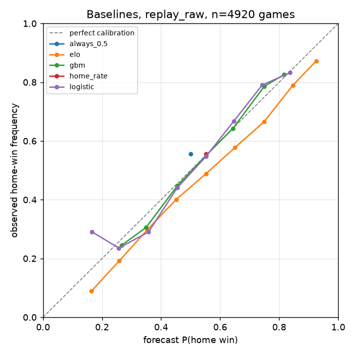

# Results report

_Generated 2026-11-22 20:19 UTC by `forecast-lab report`. Every number is labelled with the mode that produced it._

## Baselines (mode `replay_raw`, walk-forward)

Data snapshot `dd9e4a62ab14bbcf`, forecasts made 60 min before tip-off, evaluated on 4920 regular-season games from 2022-10-01. Δ vs Elo, 95% paired bootstrap CI.

| model | n | brier | log_loss | accuracy | ece | d_brier_vs_ref | ci_low | ci_high | p_holm |
|---|---|---|---|---|---|---|---|---|---|
| logistic | 4920 | 0.2184 | 0.6267 | 0.6486 | 0.0243 | -5.78e-05 | -3.19e-03 | 3.09e-03 | 1.0000 |
| elo | 4920 | 0.2184 | 0.6273 | 0.6506 | 0.0659 | – | – | – | – |
| gbm | 4920 | 0.2188 | 0.6275 | 0.6453 | 0.0145 | 3.86e-04 | -2.53e-03 | 3.37e-03 | 1.0000 |
| home_rate | 4920 | 0.2472 | 0.6876 | 0.5555 | 3.48e-03 | 0.0288 | 0.0240 | 0.0334 | 4.00e-04 |
| always_0.5 | 4920 | 0.2500 | 0.6931 | 0.4445 | 0.0555 | 0.0316 | 0.0262 | 0.0368 | 4.00e-04 |

Market baseline: **missing** for historical games (no free historical odds source; not approximated).

## Live mode

_No live predictions yet._

## Limitations

- **Contamination.** LLMs may have memorized historical NBA results. Only `live` results are
  clean. `replay_anonymized` masks team names, player names and dates in prompts and tool
  outputs, which reduces but does not eliminate contamination (a model could still infer a
  team from its statistical profile). `replay_raw` LLM numbers are never primary evidence.
- **Sample size.** Single-game outcomes are noisy; differences in Brier of ~0.002 need
  thousands of games to resolve. Comparisons below the configured minimum sample are
  marked "insufficient data".
- **Market data.** No free historical odds source was available, so the market baseline is
  missing in replay modes and is not approximated. In live mode it requires an
  `ODDS_API_KEY`.
- **Injury data.** Historical, timestamped injury reports were not available in a reliable
  machine-readable form, so the injury tool is disabled in replay modes.
- **Result timing.** Historical data has tipoff times but not final-whistle times, so a
  result is treated as knowable 210 minutes after tipoff (conservative).
- **API model drift.** Hosted models can change behind a fixed model ID. Every record logs
  the model ID and date; results are conditional on that snapshot.
- **No sampling control.** Current Claude models reject temperature settings, so run-to-run
  variance is estimated with repeated runs (`repeats`) instead of a fixed temperature.
