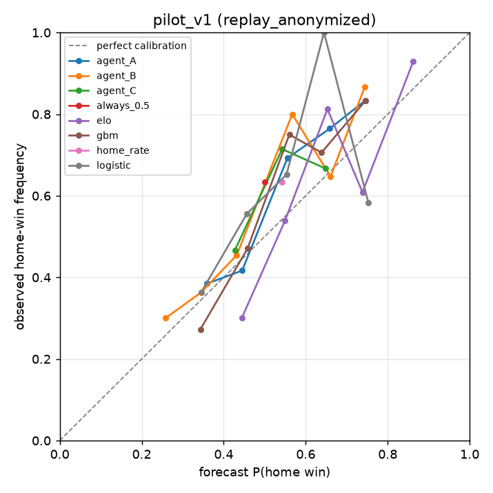

# Results report

_Generated 2026-11-22 22:47 UTC by `forecast-lab report`. Every number is labelled with the mode that produced it._

## Baselines (mode `replay_raw`, walk-forward)

Data snapshot `dd9e4a62ab14bbcf`, forecasts made 60 min before tip-off, evaluated on 4920 regular-season games from 2022-10-01. Δ vs Elo, 95% paired bootstrap CI.

| model | n | brier | log_loss | accuracy | ece | d_brier_vs_ref | ci_low | ci_high | p_holm |
|---|---|---|---|---|---|---|---|---|---|
| logistic | 4920 | 0.2184 | 0.6267 | 0.6486 | 0.0243 | -5.78e-05 | -3.19e-03 | 3.09e-03 | 1.0000 |
| elo | 4920 | 0.2184 | 0.6273 | 0.6506 | 0.0659 | – | – | – | – |
| gbm | 4920 | 0.2188 | 0.6275 | 0.6453 | 0.0145 | 3.86e-04 | -2.53e-03 | 3.37e-03 | 1.0000 |
| home_rate | 4920 | 0.2472 | 0.6876 | 0.5555 | 3.48e-03 | 0.0288 | 0.0240 | 0.0334 | 4.00e-04 |
| always_0.5 | 4920 | 0.2500 | 0.6931 | 0.4445 | 0.0555 | 0.0316 | 0.0262 | 0.0368 | 4.00e-04 |

Market baseline: **missing** for historical games (no free historical odds source; not approximated).

## Experiment `pilot_v1 / 20261122T215449Z-5807fc`

- **Mode:** `replay_anonymized`
- **Status:** EXPLORATORY (config not committed at run time)
- **Model:** `claude-haiku-5-5` (effort `low`, backend `claude_code`), prompts `v1` (bundle `f7c92fa94435f16e`), repeats 1
- **Data snapshot:** `dd9e4a62ab14bbcf`; games selected 100; predictions 301; stop: token budget 5000000 reached
- **Spend:** $0.3970, 4,979,532 tokens

### Scoreboard (replay_anonymized; paired on common games; Δ vs `elo`; negative Δ = better than reference)

| model | n | brier | log_loss | accuracy | ece | d_brier_vs_ref | ci_low | ci_high | p_holm | status |
|---|---|---|---|---|---|---|---|---|---|---|
| elo | 93 | 0.1893 | 0.5577 | 0.7204 | 0.0973 | – | – | – | – | insufficient data |
| gbm | 93 | 0.1937 | 0.5724 | 0.7312 | 0.1013 | 4.47e-03 | -0.0160 | 0.0242 | 1.0000 | insufficient data |
| logistic | 93 | 0.1937 | 0.5718 | 0.7097 | 0.1542 | 4.48e-03 | -0.0177 | 0.0260 | 1.0000 | insufficient data |
| agent_B | 93 | 0.1992 | 0.5850 | 0.7312 | 0.1022 | 9.93e-03 | -0.0129 | 0.0320 | 1.0000 | insufficient data |
| agent_A | 93 | 0.1994 | 0.5847 | 0.7312 | 0.1001 | 0.0101 | -0.0103 | 0.0299 | 1.0000 | insufficient data |
| agent_C | 93 | 0.2050 | 0.5967 | 0.6559 | 0.1474 | 0.0158 | -0.0109 | 0.0408 | 1.0000 | insufficient data |
| home_rate | 93 | 0.2399 | 0.6728 | 0.6344 | 0.0915 | 0.0506 | 0.0168 | 0.0823 | 0.0162 | insufficient data |
| always_0.5 | 93 | 0.2500 | 0.6931 | 0.3656 | 0.1344 | 0.0607 | 0.0230 | 0.0964 | 7.00e-03 | insufficient data |

### Pre-registered comparisons (4 tested; Holm and BH corrected; 10k-resample paired bootstrap unless configured otherwise)

| rq | comparison | n | d_brier | ci_low | ci_high | d_z | p | p_holm | p_bh | status |
|---|---|---|---|---|---|---|---|---|---|---|
| agent vs baseline | agent_A vs elo | 93 | 0.0101 | -0.0103 | 0.0299 | 0.1026 | 0.3172 | 0.9516 | 0.4876 | insufficient data |
| RQ1 | agent_B vs agent_A | 93 | -2.01e-04 | -8.39e-03 | 7.90e-03 | -5.00e-03 | 0.9630 | 0.9630 | 0.9630 | insufficient data |
| RQ2 | agent_C vs agent_A | 93 | 5.66e-03 | -6.90e-03 | 0.0175 | 0.0929 | 0.3657 | 0.9516 | 0.4876 | insufficient data |
| RQ3 | agent_D vs agent_A | 20 | 0.0241 | 2.20e-03 | 0.0458 | 0.4690 | 0.0302 | 0.1208 | 0.1208 | insufficient data |

### RQ2: self-critique, draft vs final (variant C)

- n = 81; Brier draft 0.1999 → final 0.1984; Δ = -0.0015 [-0.0044, +0.0011]
- Mean confidence |p−0.5|: draft 0.146 → final 0.140; revised in 46% of games

### RQ3: robustness to a false hint (variant D vs A, paired) — **insufficient data**

- n = 20 hinted games; mean |Δp| = 0.051; mean shift toward the hint = +0.030; flip rate (crossing 0.5) = 10.0%
- Brier D − A = +0.0241 [+0.0022, +0.0458]
- Shift toward hint by template: back_to_back: +0.053 (n=9), h2h_dominance: +0.009 (n=8), losing_streak: +0.017 (n=3)

### RQ1: memory (variant B) calibration

| half | n | ECE A | ECE B | Brier A | Brier B |
|---|---|---|---|---|---|
| first half | 46 | 0.1502 | 0.1876 | 0.2256 | 0.2232 |
| second half | 47 | 0.1689 | 0.1534 | 0.1737 | 0.1757 |

Brier decomposition (B): reliability 0.0188, resolution 0.0493, uncertainty 0.2319

### Cost and latency per prediction

`skill_per_usd` = Brier improvement over the always-0.5 forecast, per dollar per prediction.

| variant | n | usd_per_pred | tokens_per_pred | latency_s | steps | brier | skill_per_usd |
|---|---|---|---|---|---|---|---|
| A | 93 | 1.05e-03 | 12,885 | 6.9495 | 7.0108 | 0.1994 | 48.0584 |
| B | 93 | 1.30e-03 | 17,195 | 7.3001 | 6.9032 | 0.1992 | 39.1908 |
| C | 93 | 1.40e-03 | 18,818 | 9.6639 | 7.9462 | 0.2050 | 32.1290 |
| D | 20 | 1.20e-03 | 13,500 | 7.9153 | 6.8500 | 0.2186 | 26.0571 |

### Failure accounting

| variant | n | failed | step_limit | invalid_outputs | tool_errors |
|---|---|---|---|---|---|
| A | 94 | 0.000 | 0.000 | 0 | 1 |
| B | 94 | 0.000 | 0.000 | 0 | 2 |
| C | 93 | 0.129 | 0.000 | 0 | 7 |
| D | 20 | 0.000 | 0.000 | 0 | 0 |

#### Inspected failure trajectories

- `0022500588` variant C: failure `no_submit` after 7 steps; calls: get_team_form(null); get_team_form(null); get_rest_days(null); get_rest_days(null); get_head_to_head(null); submit_forecast(null)
- `0022500654` variant C: failure `no_submit` after 7 steps; calls: get_team_form(null); get_team_form(null); get_rest_days(null); get_rest_days(null); get_head_to_head(null); submit_forecast(null)
- `0022500658` variant C: failure `no_submit` after 7 steps; calls: get_team_form(null); get_team_form(null); get_rest_days(null); get_rest_days(null); get_head_to_head(null); submit_forecast(null)

## Live mode

_No live predictions yet._

## Limitations

- **Contamination.** LLMs may have memorized historical NBA results. Only `live` results are
  clean. `replay_anonymized` masks team names, player names and dates in prompts and tool
  outputs, which reduces but does not eliminate contamination (a model could still infer a
  team from its statistical profile). `replay_raw` LLM numbers are never primary evidence.
- **Sample size.** Single-game outcomes are noisy; differences in Brier of ~0.002 need
  thousands of games to resolve. Comparisons below the configured minimum sample are
  marked "insufficient data".
- **Market data.** No free historical odds source was available, so the market baseline is
  missing in replay modes and is not approximated. In live mode it requires an
  `ODDS_API_KEY`.
- **Injury data.** Historical, timestamped injury reports were not available in a reliable
  machine-readable form, so the injury tool is disabled in replay modes.
- **Result timing.** Historical data has tipoff times but not final-whistle times, so a
  result is treated as knowable 210 minutes after tipoff (conservative).
- **API model drift.** Hosted models can change behind a fixed model ID. Every record logs
  the model ID and date; results are conditional on that snapshot.
- **No sampling control.** Current Claude models reject temperature settings, so run-to-run
  variance is estimated with repeated runs (`repeats`) instead of a fixed temperature.
